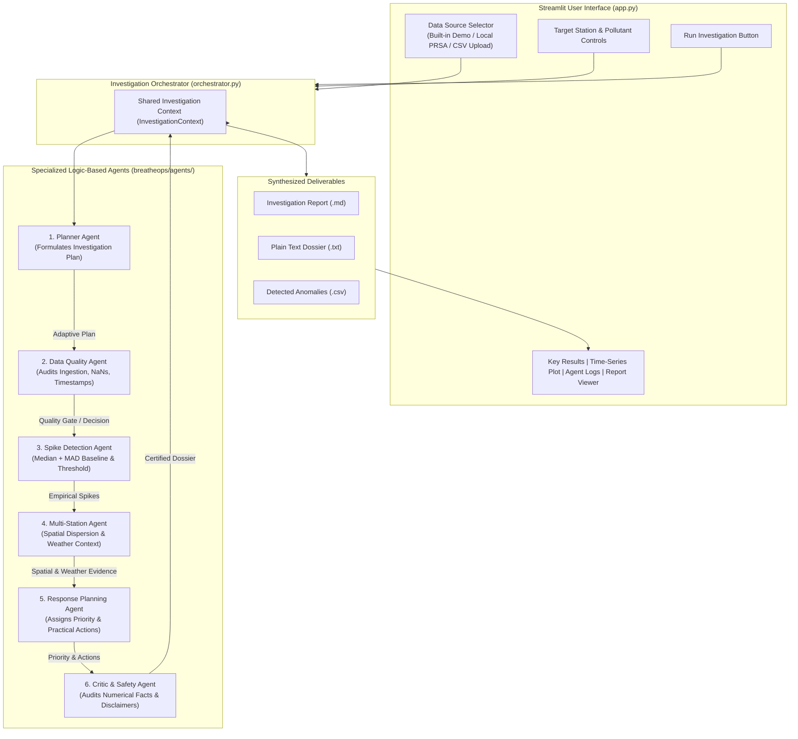

# BreatheOps AI — Multi-Agent Air Quality Investigation Centre

**Autonomous Environmental Monitoring, Statistical Event Detection & Validated Advisory Dossier Generation**

---

## 📌 1. Project Overview & Problem Statement

### 1.1 Existing Problem
Traditional municipal and industrial environmental monitoring systems face critical shortcomings:
- **Static Threshold Fragility**: Most alerting systems use rigid thresholds (e.g., fixed AQI buckets). A reading of 150 µg/m³ might be a routine seasonal peak in winter but an alarming industrial spike in summer.
- **Outlier Sensitivity**: Conventional baseline metrics relying on arithmetic mean and sample standard deviation are easily corrupted by the very pollution spikes they are designed to detect.
- **Lack of Operational Context**: Simple sensor alarms tell operators *that* a number is high, but fail to explain *why*: Was it a localized sensor failure? Did adjacent stations see the same spike? Did atmospheric stagnation trap emissions?
- **Premature Escalation or Complacency**: Operators either declare false emergencies due to single-point hardware glitches or miss subtle regional inversions.

### 1.2 Proposed Solution: BreatheOps AI
**BreatheOps AI** is an explainable, autonomous multi-agent air-quality investigation system. It combines:
1. **Robust Non-Parametric Statistics**: Station-specific baselines computed via **Median and Median Absolute Deviation (MAD)** ($1.4826 \times \text{MAD}$), which have a 50% breakdown point and remain uncorrupted by extreme outliers.
2. **Coordinated Multi-Agent Architecture**: Six specialized, deterministic Python agents that sequentially formulate a plan, audit data quality, detect spikes, cross-reference adjacent stations, analyze contextual weather variables, formulate prioritized recommendations, and independently audit scientific safety.
3. **Evidence-Grounded Dossier Synthesis**: Automatically generates certified, human-readable investigation reports available in both Markdown and Plain Text formats for environmental operators and regulatory panels.

---

## 🏛️ 2. Architecture & Multi-Agent Workflow

### 2.1 System Architecture Diagram (Mermaid)



### 2.2 Text / Presentation Architecture Diagram

```
+-----------------------------------------------------------------------------------+
|                  STREAMLIT USER INTERFACE (app.py)                                |
|  - Source Switcher: Built-in Demo (Seed 42) | Beijing PRSA Samples | CSV Upload   |
|  - Controls: Target Station | Target Pollutant | Timeframe | Sensitivity (k*MAD)  |
+-----------------------------------------------------------------------------------+
                                      │
                                      ▼
+-----------------------------------------------------------------------------------+
|               INVESTIGATION ORCHESTRATOR (orchestrator.py)                        |
|                     Coordinates Shared InvestigationContext                       |
+-----------------------------------------------------------------------------------+
                                      │
    ┌─────────────────────────────────┴─────────────────────────────────┐
    ▼                                                                   ▼
[Step 1: Planner Agent]                                       [Step 2: Data Quality Agent]
  - Inspects dataset schema                                     - Validates timestamps & deduplicates
  - Formulates step-by-step plan                                - Evaluates sample sufficiency (min 24h)
    │                                                           - Quality Gate: CAN_PROCEED / BLOCKED
    └─────────────────────────────────┬─────────────────────────────────┘
                                      │
    ┌─────────────────────────────────┴─────────────────────────────────┐
    ▼                                                                   ▼
[Step 3: Spike Detection Agent]                               [Step 4: Multi-Station Agent]
  - Historical Median baseline                                  - Evaluates adjacent station window
  - Scaled MAD (1.4826 * MAD) threshold                         - Classifies: Isolated vs Regional
  - Flags empirical anomaly timestamps                          - Extracts wind speed, dir & precip
    │                                                           - Enforces non-causal distinction
    └─────────────────────────────────┬─────────────────────────────────┘
                                      │
    ┌─────────────────────────────────┴─────────────────────────────────┐
    ▼                                                                   ▼
[Step 5: Response Planning Agent]                             [Step 6: Critic & Safety Agent]
  - Assigns priority rating                                     - Numerical consistency audit
  - Generates proportional action plan                          - Language guardrails (no emergency/causal bias)
  - Details target teams & urgency                              - Certifies: VALIDATED / HUMAN REVIEW
    └─────────────────────────────────┬─────────────────────────────────┘
                                      │
                                      ▼
+-----------------------------------------------------------------------------------+
|               FINAL EVIDENCE-BASED INVESTIGATION DOSSIER                          |
|  - Interactive Plotly Time-Series with Highlighted Anomaly Markers                |
|  - Downloadable Markdown Report (.md) & Plain Text Report (.txt)                  |
|  - Exportable Anomaly Observations Table (.csv)                                   |
+-----------------------------------------------------------------------------------+
```

---

## 🤖 3. Specialized Agents & Roles

| Agent | Module | Primary Responsibility | Key Output Fields |
| :--- | :--- | :--- | :--- |
| **Planner Agent** | [`breatheops/agents/planner.py`](file:///c:/Users/Ishan%20Sharma/OneDrive/Ishan/FAAI/FAAI%20Project/breatheops/agents/planner.py) | Analyzes dataset shape, available columns, and station count; generates tailored execution queue. | `plan_id`, `planned_steps`, `available_pollutants`, `can_proceed` |
| **Data Quality Agent** | [`breatheops/agents/data_quality.py`](file:///c:/Users/Ishan%20Sharma/OneDrive/Ishan/FAAI/FAAI%20Project/breatheops/agents/data_quality.py) | Audits nulls, timestamps, duplicates, and checks if sample size is sufficient ($\ge 24$ hours). | `decision` (`CAN_PROCEED`, `PROCEED_WITH_LIMITATIONS`, `BLOCKED`), `usable_rows`, `missing_target_percentage` |
| **Pollution Spike Agent** | [`breatheops/agents/spike_detection.py`](file:///c:/Users/Ishan%20Sharma/OneDrive/Ishan/FAAI/FAAI%20Project/breatheops/agents/spike_detection.py) | Computes historical Median baseline and MAD threshold; flags unusual readings. | `baseline_median`, `threshold_value`, `anomaly_count`, `peak_anomaly_value`, `earliest_ts`, `latest_ts` |
| **Multi-Station Agent** | [`breatheops/agents/multi_station.py`](file:///c:/Users/Ishan%20Sharma/OneDrive/Ishan/FAAI/FAAI%20Project/breatheops/agents/multi_station.py) | Compares concurrent readings at other stations during the event window; examines wind speed & direction. | `spatial_classification` (`ISOLATED_LOCAL_ELEVATION` vs `CO_OCCURRING_REGIONAL_ELEVATION`), `weather_context` |
| **Response Planner Agent** | [`breatheops/agents/response_planner.py`](file:///c:/Users/Ishan%20Sharma/OneDrive/Ishan/FAAI/FAAI%20Project/breatheops/agents/response_planner.py) | Assigns transparent priority and details actionable follow-up tasks with empirical rationales. | `assigned_priority`, `priority_reasoning`, `recommendations` (team, urgency, rationale, steps) |
| **Critic & Safety Agent** | [`breatheops/agents/critic.py`](file:///c:/Users/Ishan%20Sharma/OneDrive/Ishan/FAAI/FAAI%20Project/breatheops/agents/critic.py) | Validates numerical consistency, strips unauthorized causal/emergency claims, checks proportionality. | `validation_status` (`VALIDATED` / `REQUIRES_HUMAN_REVIEW`), `audit_checks`, `modifications_made` |

---

## 📐 4. Statistical Anomaly Detection Methodology

### 4.1 Station Historical Baseline
For a series of valid hourly measurements $X = [x_1, x_2, \dots, x_N]$ for a given station and pollutant:
$$\text{Baseline} = \text{Median}(X)$$

### 4.2 Robust Dispersion (MAD)
$$\text{MAD} = \text{Median}(|X - \text{Median}(X)|)$$
$$\text{Scale} = 1.4826 \times \text{MAD}$$

*Note on Constant 1.4826*: In a standard normal distribution, the 75th percentile is approximately $0.6745 \times \sigma$. Thus, multiplying MAD by $\frac{1}{\Phi^{-1}(0.75)} \approx 1.4826$ makes MAD an asymptotically unbiased estimator of standard deviation while retaining a 50% breakdown point.

### 4.3 Fallback Estimators for Stepped / Low-Dispersion Data
If $\text{MAD} == 0$ (e.g. repeated low integers or stepped sensor resolution):
1. **Mean Absolute Deviation Fallback**:
   $$\text{Scale}_{\text{mean\_ad}} = 1.2533 \times \text{Mean}(|X - \text{Median}(X)|)$$
2. **Sample Standard Deviation Fallback**:
   $$\text{Scale}_{\text{std}} = \text{std}(X, \text{ddof}=1)$$
3. **Zero Dispersion**: Flags constant flatline sensors without division-by-zero errors.

### 4.4 Anomaly Decision Rule
$$\text{Threshold} = \text{Median}(X) + k \times \text{Scale}$$
Where default $k = 3.0$ (corresponding to a robust 3-sigma equivalent). Any observation $x_i > \text{Threshold}$ is flagged as an empirical anomaly spike.

---

## 🗂️ 5. Project Structure

```
├── app.py                         # Complete Streamlit UI with 6-stage investigation layout
├── breatheops/                    # Core Python package
│   ├── __init__.py                # Package exports & version metadata
│   ├── data_loader.py             # CSV loading, validation & column alias normalization
│   ├── demo_data.py               # Reproducible synthetic air-quality time-series generator
│   ├── analysis.py                # Median & MAD baseline and statistical anomaly engine
│   ├── orchestrator.py            # Multi-agent orchestrator & dual-format report generator
│   └── agents/                    # Specialized agent implementations
│       ├── __init__.py            # Agent exports
│       ├── base.py                # AgentResult, AgentStatus, BaseAgent
│       ├── planner.py             # Planner Agent
│       ├── data_quality.py        # Data Quality Agent
│       ├── spike_detection.py     # Pollution Spike Detection Agent
│       ├── multi_station.py       # Multi-Station Context Agent
│       ├── response_planner.py    # Response Planning Agent
│       └── critic.py              # Critic & Safety Agent
├── tests/                         # Automated test suite (27 tests)
│   ├── __init__.py
│   ├── test_breatheops.py         # Phase 1 unit & baseline tests
│   ├── test_agents.py             # Phase 2 multi-agent & critic tests
│   └── test_phase3_robustness.py  # Phase 3 robustness, error handling & format tests
├── PRSA_Data_20130301-20170228/    # Reference Beijing Multi-Site observation datasets
├── requirements.txt               # Dependencies
├── DEMO_SCRIPT.md                 # 2-minute faculty demonstration guide
└── README.md                      # Comprehensive documentation
```

---

## 🚀 6. Installation & Execution Guide

### 6.1 Prerequisites
- Python 3.10+ (tested on Python 3.13)
- pip

### 6.2 Install Dependencies
```bash
pip install -r requirements.txt
```

Core libraries: `streamlit>=1.30.0`, `pandas>=2.0.0`, `numpy>=1.24.0`, `scipy>=1.10.0`, `plotly>=5.15.0`, `pytest>=7.0.0`.

### 6.3 Run the Application
```bash
streamlit run app.py
```
Open your browser to: **`http://localhost:8501`**.

### 6.4 Run the Full Test Suite
```bash
pytest -v
```
*Executes all 27 tests in under 8 seconds.*

---

## 📁 7. Expected CSV Formats & Upload Instructions

BreatheOps AI accepts CSV files in the **Beijing Multi-Site PRSA standard format** or custom sensor logs.

### Required Temporal Reference (at least one format):
- **Option A (ISO Datetime)**: Column named `timestamp`, `datetime`, or `date_time` (e.g. `2023-01-01 14:00:00`).
- **Option B (Date Components)**: Separate integer columns: `year`, `month`, `day`, `hour`.

### Required Pollutant Columns (at least one):
- `PM2.5`, `PM10`, `SO2`, `NO2`, `CO`, `O3` (case-insensitive, handles variants like `pm25`, `pm2_5`, `ozone`).

### Optional Meteorological Columns:
- `TEMP` (Temperature °C)
- `PRES` (Pressure hPa)
- `DEWP` (Dew Point °C)
- `RAIN` (Precipitation mm)
- `wd` (Wind Direction, e.g. `NW`, `SE`)
- `WSPM` (Wind Speed m/s)

### Optional Station Column:
- `station` (if omitted, defaults to `Default_Station`).

---

## 🔄 8. Example Investigation Workflow

1. **Ingestion & Validation**:
   - The user selects `Built-in Demo Data (Synthetic)`. The Data Quality Agent validates 1,344 hourly records across 4 stations (`Aotizhongxin`, `Changping`, `Dongsi`, `Wanliu`).
2. **Planning**:
   - The Planner Agent assigns 6 sequential execution steps, noting that cross-station comparison is active across 4 stations.
3. **Statistical Spike Detection**:
   - For `PM2.5` on station `Aotizhongxin`, the baseline median is computed as `58.0 µg/m³`, raw MAD is `12.1 µg/m³`, and threshold is `109.8 µg/m³`.
   - The agent detects an injected 10-hour spike reaching `396.4 µg/m³` (6.8× baseline).
4. **Multi-Station Context**:
   - Compares the spike window with Changping, Dongsi, and Wanliu. Other stations averaged `38.2 µg/m³`. Classifies event as `ISOLATED_LOCAL_ELEVATION`.
   - Evaluates meteorological records: Stagnant wind speed (`0.4 m/s`) from direction `ENE`, zero rain.
5. **Response Planning**:
   - Assigns priority `HIGH_PRIORITY_INVESTIGATION`.
   - Recommends: 1) Physical inlet inspection at station Aotizhongxin, 2) Sensor calibration check, 3) Meteorological boundary layer review, 4) Human expert escalation.
6. **Critic Certification**:
   - Checks that 10 detected anomalies strictly match the analytical dataset, verifies that no unauthorized regulatory emergency was declared, and certifies the dossier as `🛡️ VALIDATED`.
7. **Report Download**:
   - User downloads the complete dossier as Markdown (`.md`) or Plain Text (`.txt`).

---

## ⚠️ 9. Academic & Non-Regulatory Disclaimer

Statistical anomaly detection identifies measurements that deviate significantly from station baseline norms. This analysis does **not** represent an official regulatory violation, statutory air-quality standard compliance determination, or official environmental emergency classification. Absence of a statistical anomaly does not guarantee that the air is clean or safe under public health regulations.

---

## 🔮 10. Limitations & Future Scope

- **Current Scope**: Logic-based, deterministic agent implementation ensuring 100% reproducibility, zero token costs, and full explainability without paid LLM APIs.
- **Future Scope (Phase 4)**:
  - Integration of GIS coordinate shapefiles for Euclidean distance modeling between monitoring stations.
  - Ingestion of satellite aerosol optical depth (AOD) feeds.
  - Hybrid integration of local small-language models (e.g. SLMs via Ollama) for natural-language query answering over the certified evidence dossier.
